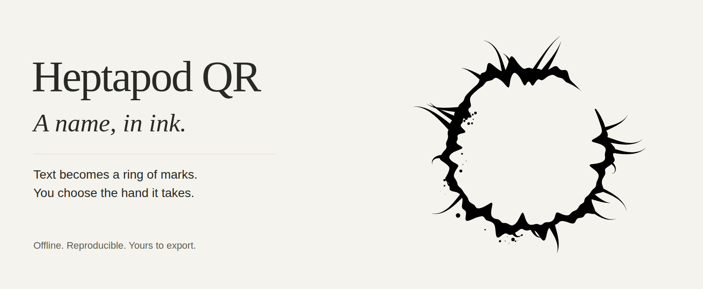
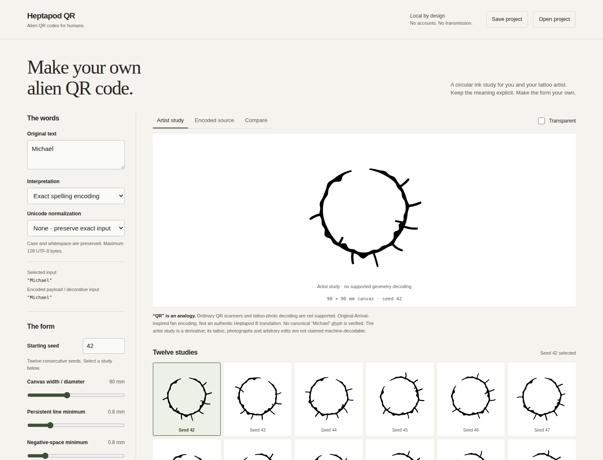
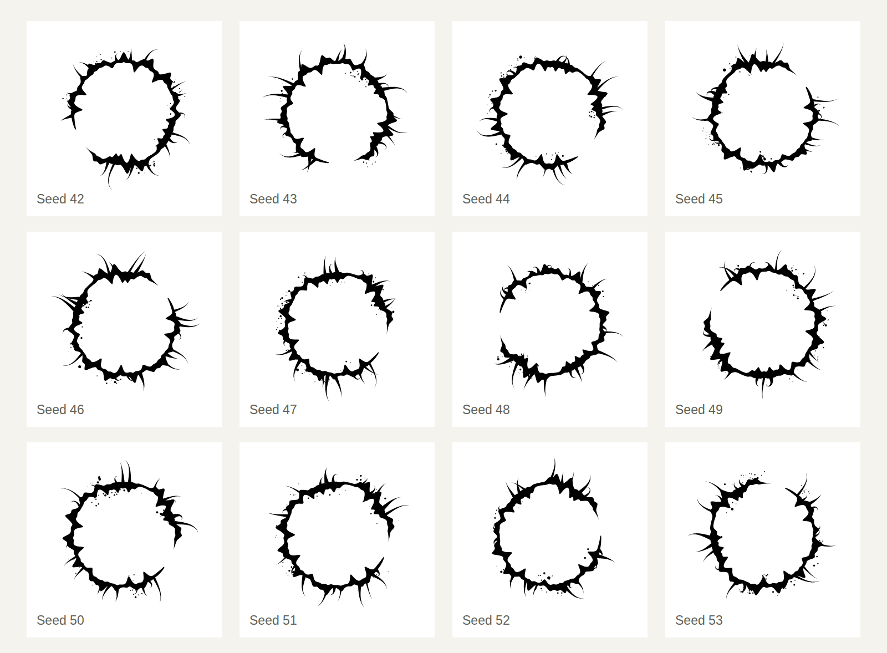
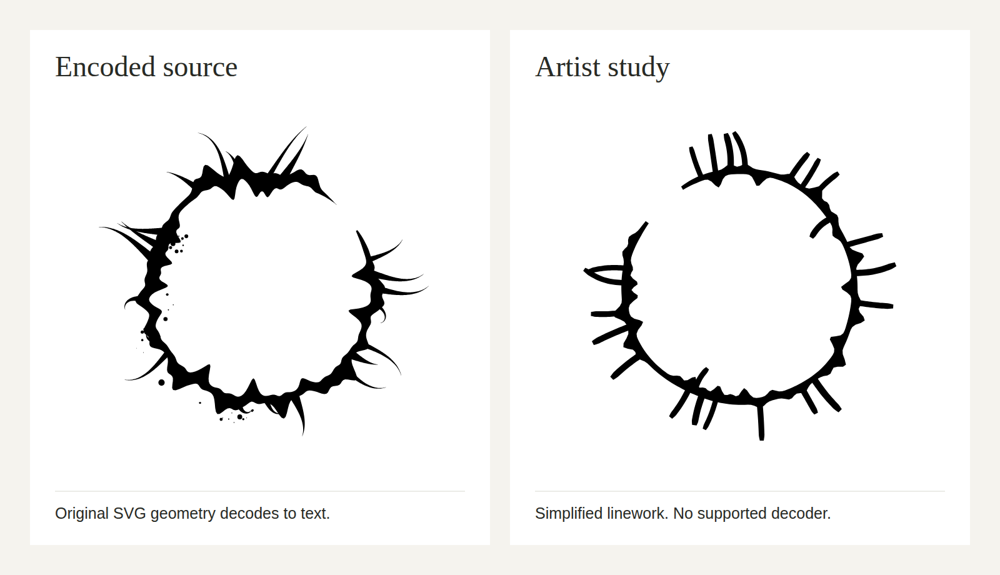

# Make your own alien QR code.

Turn a name or phrase into **Arrival-inspired circular artwork**. Explore twelve reproducible studies, compare the encoded source with an artist-facing interpretation, and export editable vectors and a measured print sheet. The whole workbench runs from a single offline HTML file.

[](https://github.com/cutler-sg/heptapod-qr/actions/workflows/verify.yml)

[Get started](#quick-start) · [Browse the artwork](examples/README.md) · [Workbench guide](docs/WORKBENCH.md) · [How it works](#how-it-works) · [Contribute](CONTRIBUTING.md)

> Original fan encoding, not an authentic Heptapod B translation. “QR” is an analogy: ordinary QR scanners cannot read these designs. The supported decoder reads preserved SVG geometry; artist studies and photographs have no supported decoder.

## Quick start

Install [Bun](https://bun.sh), then:

```sh
git clone https://github.com/cutler-sg/heptapod-qr.git
cd heptapod-qr
bun install --frozen-lockfile
bun run build
```

Open **`dist/index.html`** in a modern desktop browser. No server, account or API key required. Installing dependencies needs a connection once; using the built app does not. No telemetry, remote fonts, images or AI services are fetched. Your input stays in memory until you save it; reloading discards unsaved work.



1. **Choose your words.** Exact spelling, a meaning phrase you explicitly choose, or non-reversible decoration. Case and whitespace are preserved; NFC normalization is opt-in.
2. **Find your ring.** Compare twelve consecutive seeds, switch between source and artist views, and adjust physical dimensions and linework.
3. **Take it to your artist.** Save the project, export vectors, and print the scale-bar sheet at 100% / Actual size. Geometry screening supports review; it does not certify tattoo suitability or healing.

For a portable local archive, run `bun run release`, extract `release/heptapod-qr-0.1.0.zip`, and open the enclosed `index.html`. Version 0.1.0 has no published release download yet.

## One phrase. Twelve hands.

The same phrase, **“Who is like God?”**, encoded with seeds 42–53. Each source preserves the same payload and mark classes; the seed changes its drawn form.



The [example collections](examples/README.md) include `Michael`, `michael`, `Who is like God?`, and `There is no linear time`: **48 source/artist pairs**, plus a decorative study. After cloning, open **`examples/showcase.html`** for the offline interactive gallery. GitHub displays the HTML source rather than running it.

## From encoded source to artist study

The source carries the data. The study gives an artist editable linework to work from. Both are kept, labeled and exported separately.



| | Encoded source | Artist study | Decoration |
| --- | --- | --- | --- |
| Input | Exact text or chosen phrase | The same encoded marks | Text/seed hash |
| Geometry | Preserved codec polygons | New curves, widths and point counts | Non-reversible artwork |
| Supported decoding | Ordered source SVG coordinates + CRC | None | None |

These previews are fitted for viewing. Use the separate print sheets for physical scale. Camera scanning, tattoo decoding and recovery from artist edits are not established capabilities.

## Files you can work with

| Export | What you get |
| --- | --- |
| **Source SVG** | Preserved encoding with physical dimensions and no plaintext metadata. Geometry remains reversible. |
| **Artist / stencil SVG** | Editable filled vector paths, plus separate reversed and explicitly labeled mirrored-transfer versions. |
| **600 dpi PNG** | A preview with physical-density metadata: 2,126 × 2,126 px at a 90 mm canvas. |
| **A4 print sheet** | True-scale artwork and a 50 mm check bar. Print at 100% / Actual size; disable fit-to-page and headers/footers. |
| **Project + manifest** | Reloadable settings, payload, seed, versions and exact SVG SHA-256 hashes. These files contain your text. |
| **Comparison sheet** | Spelling, chosen meaning and decoration together, labeled source versus artist. Viewing scale only. |

See the [full export and input contracts](docs/WORKBENCH.md) and [artist review checklist](docs/ARTIST-CHECKLIST.md). Line widths and gap checks describe the designed geometry; your artist decides size, simplification and placement.

## How it works

Text, a mode bit and a CRC are packed into an integer whose decimal digits determine ordered marks around a ring. Each digit selects a swelling class and whether a tendril is present. A seed changes the drawing while preserving those classes. The source decoder reads ordered SVG coordinates, not a picture of them.

The codec is Mads R. Havmand’s MIT-licensed [heptapod-ink](https://tangled.org/mads.havmand.eu/heptapod-ink), pinned to an audited **restored geometry v1** commit. The artist renderer and export tooling are original to this project. [The upstream audit](docs/UPSTREAM-AUDIT.md) explains the exact pin and the format’s versioning history; [architecture](docs/ARCHITECTURE.md) covers the implementation.

Geometry encoding is **not encryption**. Removing plaintext metadata does not anonymize a source SVG. Imports use a bounded, validated subset; arbitrary SVG is never inserted into the page. A restrictive CSP blocks runtime connections.

## Build, verify, explore

TypeScript · Bun · Zod · Playwright · Biome. Dependencies are pinned and locked; there is no CDN or runtime backend.

```sh
bunx playwright install chromium  # One-time browser installation for checks
bun run verify                   # Types, lint, tests, deterministic builds, offline browser/gallery checks
bun run test:release              # Deterministic ZIP, checksums and unpacked offline workflows
bun run showcase                 # Rebuild the standalone interactive gallery
bun scripts/readme-assets.ts     # Rebuild README images after bun run build
```

Verification includes 29 application tests, a 2,097-case upstream hash corpus, exact-byte artwork goldens, hostile SVG/JSON rejection, exports and mobile layout checks. See [recorded results and limits](docs/TEST-RESULTS.md); Chromium on Linux is the verified browser environment. Other engines and physical printer calibration remain unverified.

[Contributing](CONTRIBUTING.md) · [Compatibility contract](docs/COMPATIBILITY.md) · [Release procedure](docs/RELEASING.md) · [Private vulnerability reporting](SECURITY.md)

## Why this exists

This started as a personal tattoo study for Michael. Comparing seeded designs with a tattoo photograph identified **“Who is like God?”, seed 46** as the closest visual match. Its paths and circles match the pinned encoder exactly; the comparison did not decode the photograph. A later image-only experiment recovered **no checksum-valid text**. The [research record](experiments/photo_decode/README.md) preserves that distinction.

“Who is like God?” is a traditional etymology of Michael, cited to [Behind the Name](https://www.behindthename.com/name/michael). The app offers it only as an explicit phrase choice. No canonical Michael glyph or complete film-name grammar is asserted; neither Ian nor Louise is used to derive one. “There is no linear time” is an original encoding of English text, not a reconstructed film glyph.

Developed with AI assistance. The artwork is generated procedurally from the documented renderer, rather than by an image model. No film assets are bundled.

MIT for original code. Upstream and runtime licenses are preserved in [THIRD_PARTY_NOTICES.md](THIRD_PARTY_NOTICES.md) and `vendor/`.
